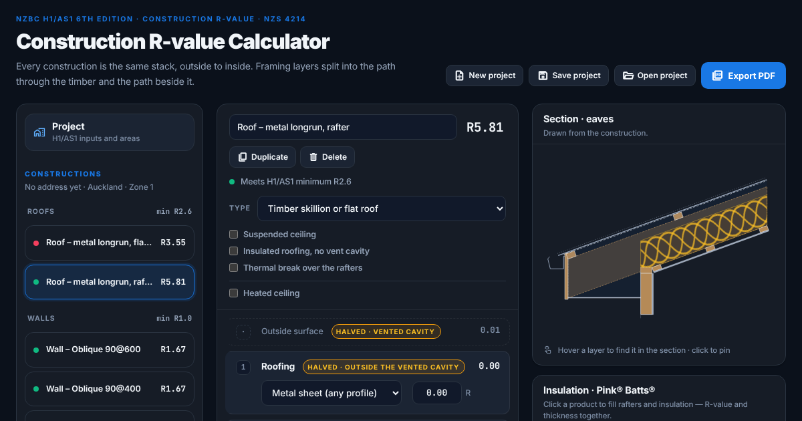

# Construction R-value Calculator

Free construction R-values for New Zealand walls, roofs and floors to **H1/AS1 6th edition** — every layer and every step shown, with a PDF report for the building consent.

[](https://rvalue.ezbuild.co.nz/)
[](LICENSE)

[](https://rvalue.ezbuild.co.nz/)

Runs in your browser — no sign-up, no install.

## What it does

- **Walls** — timber frame (vented cavity, internal strapping, thermal break, insulated cladding, external insulation), double stud, intertenancy and concrete block walls
- **Roofs** — truss roofs with a flat ceiling (including the heel and perimeter insulation), skillion and flat roofs, suspended grid and self-supporting insulated roofs
- **Floors** — suspended and solid timber floors; slab-on-ground from the Appendix E tables, including rafts, perimeter parts and H1/VM1 values
- **The method in full** — NZS 4214 isothermal planes as modified by H1/AS1 2.1.3.2: framing layers split into the path through the timber and the path beside it, with the bridged-portion maths shown
- **Checks** against the 2.1.2.11 minimums and the Table 2.1.2.12 heated minimums
- **Section drawings** for walls, roofs and suspended floors
- **Project page** with envelope areas and the rows to paste into the BRANZ H1/AS1 calculation tool, plus optional windows, doors and skylights
- **PDF calculation report**; save and open projects as files; undo and redo

Your project data stays in your browser and is never sent anywhere. Page visits and a few actions (PDF download, save / open project) are counted anonymously with [GoatCounter](https://www.goatcounter.com/) — no cookies.

## Guides

- [Why R2.8 batts make an R1.67 wall](https://rvalue.ezbuild.co.nz/guides/wall-r-value-h1-as1.html) — the H1/AS1 wall method, worked through
- [Slab-on-ground R-values: the Appendix E lookup, step by step](https://rvalue.ezbuild.co.nz/guides/slab-on-ground-r-value-h1-as1.html) — A/P, the 24 tables, rafts and the garage wall

## Request a feature or report a problem

- **GitHub:** [open an issue](https://github.com/qq624444359/NZ-Construction-R-Value/issues/new/choose) — there is a form for feature requests and one for wrong results.
- **No GitHub account?** Email [pitayadesign.ezbuild@gmail.com](mailto:pitayadesign.ezbuild@gmail.com?subject=Construction%20R-value%20calculator%20%E2%80%94%20feature%20request).

## Run it locally

It is a static site — no build step, no dependencies.

```bash
python3 -m http.server 8080
# open http://localhost:8080
```

## Code layout

| File | What it does |
|---|---|
| `index.html` | The page |
| `js/rvalue-model.js` | Materials, construction templates and the isothermal-planes calculation. No DOM — the numbers live here. |
| `js/slab-appendix-e.js` | H1/AS1 Appendix E slab-on-ground tables |
| `js/h1-data.js` | H1/AS1 minimums and reference-building data |
| `js/rvc-v6.js` | The calculator page: constructions, build-up, section, PDF |
| `js/rvc-project.js` | Project page, Windows & doors, BRANZ input |
| `js/*-section.js` | Section drawings (SVG) |
| `js/project-file.js`, `js/export-name.js` | Save / open project files, file names |

## Python package (`python/`)

The same H1 calculations in Python, with tests — not needed by the website, which runs entirely in the browser.

| Module | What it does |
|---|---|
| `h1/rvalue/engine.py` | NZS 4214 isothermal planes as modified by H1/AS1 2.1.3.2 (method only — see below) |
| `h1/engine.py` | Calculation method: reference building vs proposed heat loss |
| `h1/slab.py` | Appendix E slab-on-ground lookup |
| `h1/optimise.py`, `h1/catalogue.py` | Lowest-cost combination that complies (example catalogue, not priced) |
| `h1/branz_export.py` | Rows for the BRANZ H1/AS1 calculation workbook |
| `h1/report.py` | PDF report |
| `api.py` | Optional FastAPI app over all of the above |

```bash
cd python
pip install -r requirements.txt
pytest                         # unit tests
uvicorn api:app --port 10000   # optional HTTP API
```

**NZS 4214 Appendix E values are not included.** Standards New Zealand's notice forbids reproducing the standard without permission, so `h1/rvalue/data/nzs4214.schema.yaml` has the shape and no numbers. Fill a copy (`nzs4214.local.yaml`, gitignored) from your own copy of the standard. The BRANZ workbook is not included either — set `H1_BRANZ_TEMPLATE` to your own copy to enable `/api/h1/export`.

Design notes from the calculator's development are in `docs/design-briefs/`.

## Disclaimer

Material, air-gap and surface values are provisional defaults you can overwrite on every row. Confirm each against your own copy of NZS 4214 and the manufacturers' data before a figure goes into a building consent. The calculator does not decide compliance: the building consent authority does. Provided under the MIT License, without warranty.

NZS 4214 is published by Standards New Zealand; H1/AS1 and H1/VM1 by the Ministry of Business, Innovation and Employment. Product names (Pink® Batts®, GIB®, James Hardie and others) belong to their owners.
